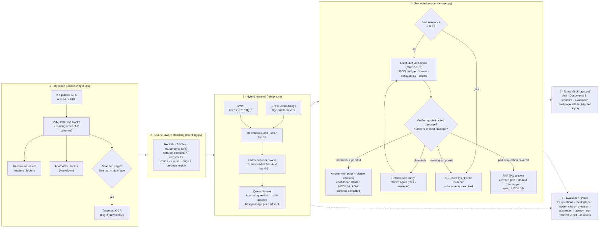

# LexiSyncAI: Evidence-Grounded Legal Document Analyst

DA3 Deep Learning & GenAI final project (SRH University Hamburg, WiSe 2025/26), by Vinay Somala.

LexiSyncAI answers questions about public legal documents (statutes, contracts, judgments) and **proves every
claim**: each sentence cites the page and clause it comes from, the cited page is shown with the region
highlighted, and the system **abstains** when the documents do not contain the evidence.



## What it does

1. Create a **case** and upload 2–5 public PDFs (or paste URLs).
2. The PDFs are parsed and the **detected structure** is shown: pages, articles/sections, tables, footnotes,
   two-column pages and **scanned pages** (OCR'd with Tesseract, or flagged if OCR is unavailable).
3. Ask a question, e.g. *"Under the GDPR, what is the maximum fine a company can receive, and which kinds of
   violations trigger the higher fine?"*
4. You get a plain-language answer with citations like `[GDPR p. 82, Article 83(5)]`, the cited page side by side
   with the cited region highlighted, a **confidence badge** (HIGH / MEDIUM / LOW / INSUFFICIENT EVIDENCE) and an
   explanation of why the evidence supports the answer, including how conflicting sources were handled.
5. A question the documents cannot answer, e.g. *"What is the governing law of the subcontractor agreement?"*,
   is refused, and the app lists the documents it searched.

## How it works

| Stage | Implementation | File |
|---|---|---|
| Ingestion | PyMuPDF text blocks; reading order for one- and two-column pages; repeated headers/footers removed; footnotes (small font, page bottom) kept separately; tables extracted as Markdown (merged cells filled); scanned pages detected (little text, large image) and OCR'd with Tesseract | `lexisync/ingest.py` |
| Chunking | **Clause-aware**, not fixed-size: recitals, articles and their numbered paragraphs (`Article 83(5)`, definitions `4(11)`), contract sections and clauses (`7`, `7.2`). Points (a), (b) stay with their paragraph; very long clauses are split at points. Each chunk keeps page numbers and on-page bounding boxes | `lexisync/chunking.py` |
| Retrieval | **BM25** (tokenizer keeps legal references such as `7.2` and `83(5)`) + **dense** embeddings (`BAAI/bge-small-en-v1.5`), merged with **Reciprocal Rank Fusion** (k = 60), then the top 30 are **reranked with a cross-encoder** (`cross-encoder/ms-marco-MiniLM-L-6-v2`). A **query planner** splits two-part questions into sub-queries and makes sure the best passage for each part reaches the LLM | `lexisync/retrieve.py`, `lexisync/embed.py` |
| Generation | Local LLM through **Ollama** (`qwen2.5:7b`, temperature 0, fixed seed) answers only from the numbered passages and returns JSON: answer, claims, passage ids per claim, a supporting quote per claim, explanation, conflicts. An OpenAI-compatible API can be used instead (`LLM_BACKEND=openai`) | `lexisync/llm.py`, `lexisync/answer.py` |
| Grounding | **Verifier loop**: every claim's quote must occur in its cited passage and every number in the claim must appear there. If a claim fails, the query is reformulated with the failed claim, retrieval runs again and the answer is regenerated (max. 2 attempts). Claims that still fail are dropped | `lexisync/answer.py` |
| Abstention | Two layers: (1) retrieval gate: if the best reranker relevance is below 0.1 the LLM is not called; (2) the LLM may set `abstain`, and an answer with no verified claim is turned into an abstention. If only part of a two-part question is covered, a **partial answer** is given and the missing part is named (confidence at most MEDIUM) | `lexisync/answer.py` |
| UI | Streamlit, three tabs: **Ask** (example questions, cited answer, confidence badge, cited page with highlighted region, claim verification, retrieval scores, latency), **Documents & structure** (upload/URL, indexing, detected structure per document) and **Evaluation** (charts of all results from `reports/`) | `app.py` |

## Run it

Requirements: Python 3.12+ (tested with 3.13), [Ollama](https://ollama.com) and optionally Tesseract (`brew install tesseract`) for scanned pages.

```bash
make setup        # virtual environment + pinned dependencies
make model        # ollama pull qwen2.5:7b
make docs         # GDPR + ePrivacy Directive from EUR-Lex into data/docs/
make index        # parse, chunk and index them into the case "GDPR ePrivacy"
make app          # http://localhost:8501
```

Or everything at once: `make all`. If EUR-Lex blocks the automatic download, `make docs` prints the two links; save the PDFs as `data/docs/gdpr.pdf` and `data/docs/eprivacy.pdf` and continue with `make index`. With Docker (Ollama keeps running on the host):

```bash
docker build -t lexisync . && docker run -p 8501:8501 lexisync
```

Reproducibility: all dependencies are pinned in `requirements.txt`, seeds are fixed (`seed: 42` in
`config.yaml`, and `temperature 0` and `seed 42` for the LLM), and all settings live in `config.yaml`.

## Evaluation

```bash
make eval-retrieval   # recall@k per retrieval configuration (no LLM, ~1 min)
make eval             # end-to-end answers for 6 configurations (~40 min on a MacBook Air M4)
make eval-resume      # continue an interrupted run (progress is saved after every question)
make eval-summary     # after filling the manual_correct column in reports/answers.csv
make ocr-bench        # OCR character accuracy
```

**Documents:** GDPR (Regulation (EU) 2016/679) and the ePrivacy Directive 2002/58/EC, both from EUR-Lex.
**Questions:** 22 held-out questions in `eval/questions.jsonl`: 12 factual, 6 multi-hop (two paragraphs, often
on two pages, one across both documents) and 4 unanswerable. Each has gold article/paragraph labels and key facts.

**Metrics**

- *Retrieval recall@k* (k = 1, 3, 5, 10) and MRR, at article and paragraph level, for `bm25`, `dense`, `hybrid`
  `hybrid_rerank` and `hybrid_rerank_mq` (with the multi-hop query planner).
- *Answer correctness*: automatic key-fact check, plus a `manual_correct` column for manual grading.
- *Citation precision*: share of cited passages that belong to a gold article.
- *Abstention accuracy*: share of unanswerable questions refused; *false abstention*: answerable questions refused.
- *Latency and tokens* per question.

**Configurations compared** (the mandatory comparison is `no_retrieval` vs `full`, and `dense_only` vs `full`):

| Config | Description |
|---|---|
| `no_retrieval` | LLM alone, no documents |
| `dense_only` | dense retrieval only, verifier on |
| `full` | hybrid + reranker + query planner + verifier (the system) |
| `full_no_planner` | ablation: query planner off |
| `full_no_verifier` | ablation: verifier loop off |
| `full_k4` | latency optimisation: 4 instead of 6 passages in the prompt |

Results are written to `reports/results.md`, `reports/retrieval.csv`, `reports/answers.csv` and `reports/summary.csv`.

### Results

Local LLM `qwen2.5:7b` (Ollama, temperature 0, seed 42) on a MacBook Air M4 (16 GB). 22 questions.

**Retrieval (paragraph level, 18 answerable questions)**

| Mode | R@1 | R@3 | R@5 | R@10 | MRR |
|---|---|---|---|---|---|
| bm25 | 0.444 | 0.639 | 0.694 | 0.806 | 0.637 |
| dense | 0.528 | 0.778 | 0.806 | 0.889 | 0.771 |
| hybrid (RRF) | 0.500 | 0.611 | 0.806 | 0.889 | 0.689 |
| hybrid + rerank | **0.722** | **0.861** | 0.861 | 0.889 | **0.917** |
| hybrid + rerank + planner | **0.722** | **0.861** | **0.889** | **0.917** | 0.907 |

The cross-encoder gives the largest gain (+22 points R@1 over hybrid). Hybrid RRF alone is slightly worse than
dense here: BM25 adds noise on paraphrased questions and RRF averages it in. The planner improves recall at
5 and 10 (the passages the LLM sees), at a small MRR cost. Full article-level table: `reports/results.md`.

**End-to-end answers**

| Config | Correct (manual) | Correct (auto) | Citation precision | Abstention accuracy | False abstention | Mean latency |
|---|---|---|---|---|---|---|
| no_retrieval | 0.556 | 0.611 | – | 0.00 | 0.00 | 10.9 s |
| dense_only | – | 0.722 | 0.833 | 1.00 | 0.06 | 26.9 s |
| **full** | **0.778** | 0.778 | 0.844 | **1.00** | 0.11 | 33.1 s |
| full_no_planner | – | 0.833 | 0.809 | 1.00 | 0.06 | 29.2 s |
| full_no_verifier | – | 0.778 | 0.844 | 1.00 | 0.11 | 27.1 s |
| full_k4 | 0.778 | 0.778 | 0.847 | 1.00 | **0.00** | **17.2 s** |

Correctness is measured on the 18 answerable questions; manual grading (`reports/grading_sheet.xlsx`) counts an
answer as correct only if it answers what was asked without a legal error.

**Findings**

- *Retrieval vs no retrieval (mandatory comparison):* correctness rises from 0.56 to 0.78 and every answer cites
  page and clause. Without documents the LLM answered all four unanswerable questions (e.g. an invented fine for
  Meta, a German tax rate); the system refused all four, in 0.2 s, at the retrieval gate.
- *Automatic vs manual grading:* the key-fact check over-rates the closed-book baseline (0.61 vs 0.56): it finds
  the right numbers in answers that are vague or partly wrong.
- *Error analysis and the one prompt revision:* a first run (`reports_run1/`) showed over-abstention on two-part
  questions: the JSON schema made the model decide `abstain` before writing any evidence. Reordering the schema
  (claims → answer → missing → abstain), allowing partial answers with a `missing` field, and a rule to keep
  default rules and exceptions apart fixed F06 and the swapped ages in F03. The baseline keeps its original prompt.
  Because the prompt was revised after looking at these questions, the numbers are optimistic; a fresh question
  set would be the clean test.
- *Planner ablation:* better retrieval did not turn into better answers on this set (0.78 with vs 0.83 without,
  one question out of 18). With six multi-hop questions this difference is within noise.
- *Verifier ablation:* no retries were triggered in the final run, so the verifier did not change answers here;
  it acts as a safety net (tests show it rejecting a wrong number and abstaining).
- *Latency optimisation:* `full_k4` (4 passages) halves latency (33 → 17 s), keeps correctness and removes the
  false abstentions, so it is the recommended setting for interactive use.
- *Remaining errors:* M04 and M06 miss the second paragraph (Art. 15(1), Art. 17(3)); in M06 the model then fills
  the gap with a wrong exception that passes the lexical verifier. M02/M03 are still refused in `full`.

## Extended features

| # | Feature | Status |
|---|---|---|
| 1 | OCR for scanned pages | Scanned pages detected and OCR'd with Tesseract; fallback flags and skips them. Accuracy measured with `make ocr-bench` (rendered digital pages vs their text layer) |
| 2 | Table extraction | PyMuPDF table detection, merged cells filled, tables indexed and cited as `(table)` |
| 4 | Bounding-box citations | Every chunk keeps its on-page regions; the cited region is highlighted on the page image |
| 5 | Planner + verifier loop | Planner splits two-part questions into sub-queries and guarantees each part's best passage reaches the LLM; verifier checks quotes and numbers, reformulates and retries (step cap 2); retry log shown in the UI |
| 7 | Ablation table | Retrieval: bm25 vs dense vs hybrid vs hybrid+rerank vs +planner. Answers: with vs without planner, with vs without verifier |
| 9 | Multi-document cross-referencing | Questions combine documents (e.g. ePrivacy Art. 5(3) + GDPR Art. 94); conflicting sources are reported in a separate "conflicts" field |
| 10 | Public deployment | Streamlit Community Cloud with an OpenAI-compatible API (see below) |
| 11 | Latency and cost report | Seconds and tokens per question; optimisation measured: `full_k4` vs `full` |

### Deployment (Streamlit Community Cloud)

A free cloud host cannot run Ollama, so the deployed demo uses an OpenAI-compatible API (for example Groq's
free tier). In the app settings, add the secrets:

```toml
LLM_BACKEND = "openai"
LLM_BASE_URL = "https://api.groq.com/openai/v1"
LLM_MODEL = "llama-3.1-8b-instant"
LLM_API_KEY = "..."
```

## Project structure

```
app.py                  Streamlit UI
config.yaml             all settings (models, k, thresholds, seed)
lexisync/
  ingest.py             PDF parsing, reading order, headers/footers, footnotes, tables, scanned pages, OCR
  chunking.py           clause-aware chunking
  embed.py              dense encoder, cross-encoder reranker (+ offline stand-ins for tests)
  retrieve.py           BM25, dense search, RRF, reranking
  llm.py                Ollama / OpenAI-compatible clients
  answer.py             grounded answering, verifier loop, abstention, confidence
  pipeline.py           cases: documents, index, ask
  render.py             page image with highlighted cited region
eval/
  questions.jsonl       22 held-out questions with gold labels
  run_eval.py           retrieval + end-to-end evaluation
scripts/                document download, case building, OCR benchmark, synthetic test PDF
tests/                  22 offline tests (run in GitHub Actions)
docs/architecture.png   one-page architecture diagram
```

## Limitations

- Clause detection is rule-based and tuned for EU legal acts and numbered contracts; unusual layouts fall back
  to paragraph chunks with page numbers.
- The verifier checks quotes and numbers lexically; it cannot judge legal reasoning (M06: a wrong exception
  shares enough words with the cited passage to pass).
- Small evaluation set (22 questions, 6 multi-hop): differences of one question are not significant.
- The closed-book baseline's abstention is unstable between runs (3/4 refused in run 1, 0/4 in run 2).
- A 7B local model can still misread complex provisions. The verifier reduces, but does not remove, this risk.

## Sources

Documents: [EUR-Lex](https://eur-lex.europa.eu), GDPR (CELEX 32016R0679) and ePrivacy Directive (CELEX 32002L0058).
Models: BAAI/bge-small-en-v1.5, cross-encoder/ms-marco-MiniLM-L-6-v2, Qwen2.5-7B-Instruct (via Ollama).
